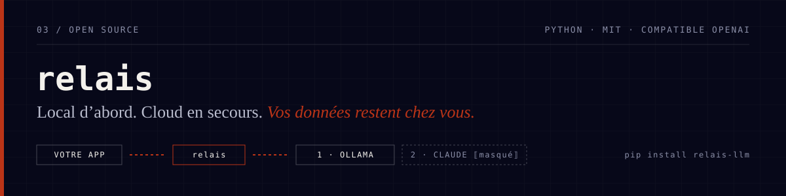

<p align="center">
  
</p>

<p align="center">
  <a href="https://github.com/finaritrak/relais/actions/workflows/ci.yml"></a>
  
  
  
  
  
</p>

<p align="center"><b>Une passerelle LLM auto-hébergée : votre modèle local répond d'abord, le cloud prend le relais en cas de besoin, et les données sensibles sont masquées avant de quitter votre réseau.</b></p>

<p align="center"><a href="#-in-english">🇬🇧 English below</a></p>

---

## Le problème

Vous faites tourner un modèle local (Ollama, vLLM…) pour la confidentialité et le coût. Mais un jour il sature, plante ou ne suffit plus. Vous basculez alors sur une API cloud, et à ce moment-là **les e-mails, téléphones et numéros de CIN de vos clients partent chez un tiers**.

`relais` se place entre vos applications et les modèles :

```text
             ┌─────────────────────────── relais ───────────────────────────┐
 votre app ──┤  1. modèle local (Ollama)    données en clair, ne sort pas   ├──▶ réponse
  (SDK       │        │ panne · saturé · lent                                │
  OpenAI)    │        ▼                                                      │
             │  2. Claude / OpenAI          ⟦EMAIL_1⟧ ⟦TEL_1⟧ masqués,     │
             │                              puis démasqués dans la réponse   │
             │  + budget journalier · cache · disjoncteur · statistiques     │
             └───────────────────────────────────────────────────────────────┘
```

Ce que voit réellement le fournisseur cloud (log d'un vrai test de bout en bout) :

```text
Requête de l'app : Envoie la facture à rakoto@example.mg et appelle le 034 12 345 67
Reçu par Claude  : Envoie la facture à ⟦EMAIL_1⟧ et appelle le ⟦TEL_1⟧
Réponse à l'app  : … rakoto@example.mg … 034 12 345 67   ← valeurs restaurées
```

## Fonctionnalités

| | |
|---|---|
| 🔌 **Compatible OpenAI** | `POST /v1/chat/completions` : tout SDK ou outil OpenAI (Python, JS, n8n, LangChain…) fonctionne en changeant `base_url` |
| 🏠 **Local d'abord** | les routes définissent un ordre (`["local", "claude"]`) ; on passe au suivant en cas d'erreur 5xx/429, de délai dépassé ou de réponse invalide |
| 📈 **Débordement en pic de charge** | quand le modèle local a atteint `max_concurrence`, les requêtes en trop partent directement vers le secours |
| 🕶️ **Masquage réversible** | e-mails, téléphones malgaches, CIN, cartes bancaires (contrôle de Luhn), IBAN, IP, plus vos propres motifs regex. Uniquement vers les fournisseurs `externe = true` |
| 💸 **Budget journalier** | les fournisseurs payants sont écartés une fois le plafond en USD atteint |
| 🔁 **Disjoncteur** | un fournisseur qui échoue plusieurs fois de suite est mis de côté quelques secondes |
| ⚡ **Cache** | les requêtes `temperature = 0` identiques ne sont facturées qu'une fois |
| 📊 **Observabilité** | en-têtes `X-Relais-Fournisseur`, `X-Relais-Masques` et `X-Relais-Cache`, endpoint `/stats`, logs **sans le contenu des messages** |
| 🔐 **Clés clients** | `Authorization: Bearer …`, comparaison en temps constant |

## Démarrage rapide

### Avec Docker (Ollama + relais)

```bash
git clone https://github.com/finaritrak/relais && cd relais
cp relais.example.toml relais.toml     # remplacez base_url du fournisseur local par http://ollama:11434/v1
export ANTHROPIC_API_KEY=sk-ant-…  RELAIS_CLES_CLIENTS=ma-cle
docker compose up -d
docker compose exec ollama ollama pull qwen2.5:7b
```

### Avec pip

```bash
pip install relais-llm
cp relais.example.toml relais.toml
relais check            # vérifie la configuration et affiche les routes
relais serve            # http://127.0.0.1:8080
```

### Utilisation depuis votre code

```python
from openai import OpenAI

client = OpenAI(base_url="http://localhost:8080/v1", api_key="ma-cle")
r = client.chat.completions.create(
    model="defaut",  # nom de la route
    messages=[{"role": "user", "content": "Résume le dossier de rakoto@example.mg"}],
)
```

```bash
curl http://localhost:8080/v1/chat/completions \
  -H "Authorization: Bearer ma-cle" -H "Content-Type: application/json" \
  -d '{"model": "defaut", "messages": [{"role": "user", "content": "Salama !"}]}'
```

### Tester le masquage sans serveur

```bash
$ relais masquer "Client: rakoto@example.mg, tél 034 12 345 67, CIN 101 211 123 456"
Client: ⟦EMAIL_1⟧, tél ⟦TEL_1⟧, CIN ⟦CIN_1⟧
```

## Configuration

Tout tient dans un fichier TOML : voir [`relais.example.toml`](relais.example.toml), entièrement commenté.

```toml
[[fournisseurs]]
nom = "local"
type = "openai"                       # Ollama, vLLM, LM Studio, OpenAI, Mistral…
base_url = "http://localhost:11434/v1"
modele = "qwen2.5:7b"
externe = false                       # pas de masquage : les données restent chez vous
max_concurrence = 2                   # au-delà : débordement vers le fournisseur suivant

[[fournisseurs]]
nom = "claude"
type = "anthropic"
base_url = "https://api.anthropic.com"
modele = "claude-sonnet-5-5"
cle_api_env = "ANTHROPIC_API_KEY"
externe = true                        # masquage activé

[routes]
defaut = ["local", "claude"]
local-seul = ["local"]                # données ultra-sensibles : jamais de cloud

[budget]
journalier_usd = 5.0
```

## Limites connues (v0.1)

- **Pas de streaming** (`stream: true` renvoie une erreur 400) : c'est la prochaine fonctionnalité prévue.
- **Pas d'appels d'outils** (*tool calling*) ni d'images transmises à Claude.
- **Les noms de personnes ne sont pas détectés** : il faudrait un modèle NER. En attendant, ajoutez des motifs perso ou utilisez la route `local-seul`.
- Budget, cache et statistiques sont **en mémoire** : ils repartent de zéro au redémarrage.
- Le masquage réduit fortement le risque, mais ne garantit pas une anonymisation totale. Pour les données réglementées, gardez-les sur une route locale.

## Feuille de route

- [ ] Streaming (SSE) avec démasquage à la volée
- [ ] Détection des noms par NER locale (spaCy / modèle local)
- [ ] Persistance du budget et des statistiques (SQLite), export Prometheus
- [ ] Routage par coût et latence observée
- [ ] Tool calling

## Développement

```bash
pip install -e ".[dev]"
ruff check . && mypy && pytest --cov
```

50 tests, couverture de 98 %, mypy en mode strict. Les fournisseurs sont simulés avec `httpx.MockTransport` : aucun appel réseau réel.

---

## 🇬🇧 In English

**relais** is a self-hosted, OpenAI-compatible LLM gateway. Requests go to your **local model first** (Ollama, vLLM…). On errors, timeouts or saturation, they **fail over to a cloud model** (Claude, OpenAI). Before anything leaves your network, **sensitive data is replaced by reversible tokens** (emails, phone numbers, national IDs, cards with Luhn check, IBANs, IPs, custom regexes) and restored in the answer. It also has daily USD budget caps, a circuit breaker, a cache for deterministic requests, `/stats`, and content-free logs.

```bash
pip install relais-llm && relais check && relais serve
```

Point any OpenAI SDK at `http://localhost:8080/v1` and you're done.

---

<p align="center"><sub>Né d'une architecture de supervision énergétique en production : modèle local entraîné sur site, bascule automatique vers l'API Claude en pic de charge.<br>
Fait à Antananarivo par <a href="https://finaritra.katonne.com">Aina Finaritra Rakotonindrainy</a> · <a href="https://katonne.com">Katonne</a></sub></p>
